# Intel Scene Classification

Image classification on the [Intel Image Classification dataset](https://www.kaggle.com/datasets/puneet6060/intel-image-classification) (6 scene classes: buildings, forest, glacier, mountain, sea, street).

Builds and compares three models:
1. **Baseline CNN** — custom Conv2D stack trained from scratch.
2. **VGG16 Transfer Learning** — ImageNet-pretrained VGG16, frozen → fine-tuned (last conv block unfrozen).
3. **Ensemble** — bagged Dense heads on VGG16 bottleneck features, plus a baseline+VGG16 softmax average.

Includes Grad-CAM visualizations and misclassification analysis.

## Results

| Model | Test Accuracy |
|---|---|
| Baseline CNN | see `images/model_comparison.png` |
| VGG16 (fine-tuned) | see `images/model_comparison.png` |
| Ensemble | ~0.93 |

## Notebook

[`fda-project.ipynb`](fda-project.ipynb) — full pipeline: data loading, augmentation, training (baseline CNN + VGG16 transfer/fine-tuning), Grad-CAM, bagged-ensemble heads, evaluation, single-image inference.

## Visuals

| | |
|---|---|
| 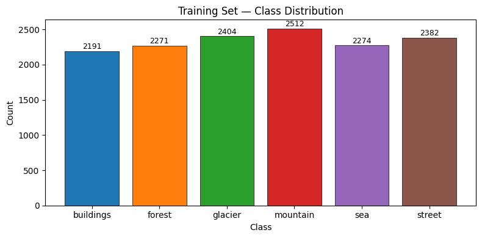 | 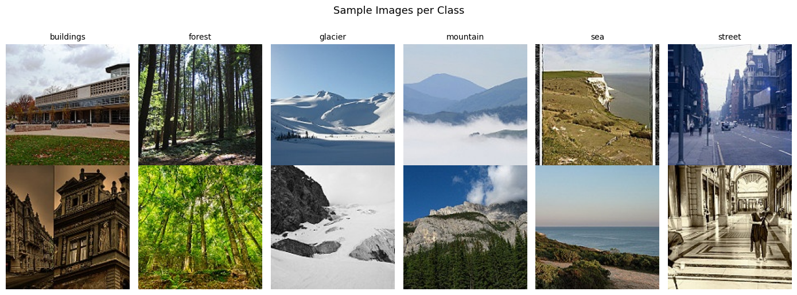 |
| 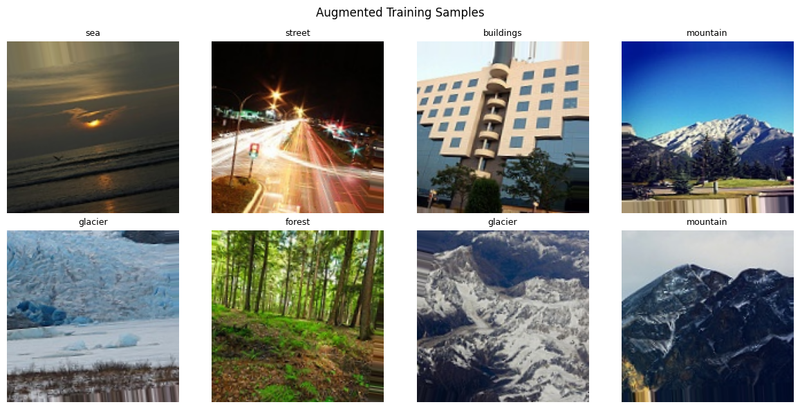 | 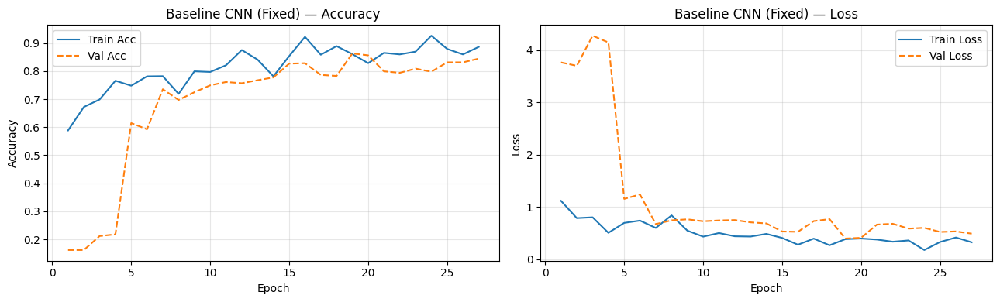 |
| 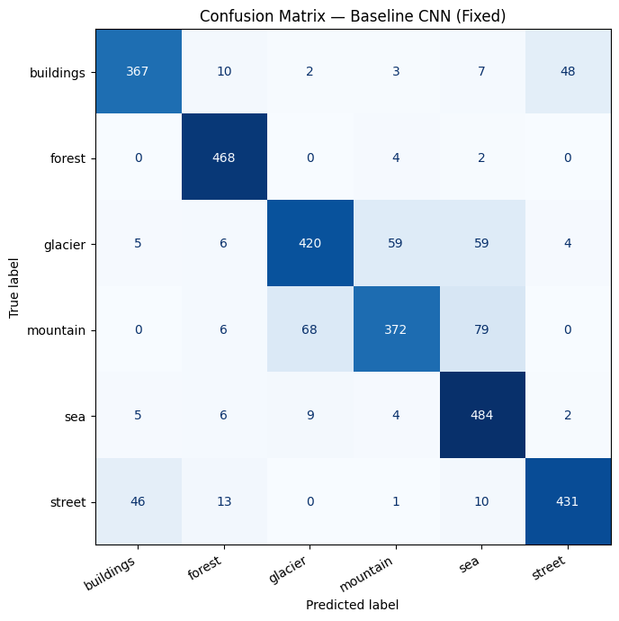 | 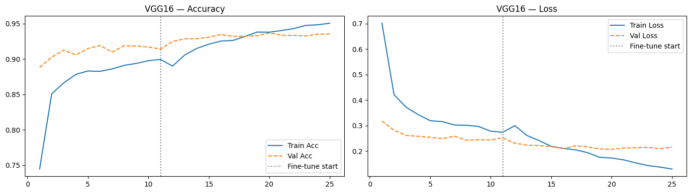 |
| 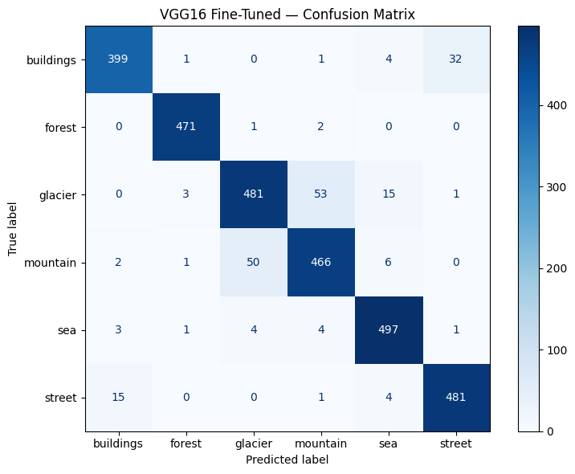 | 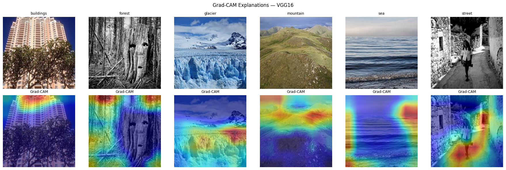 |
| 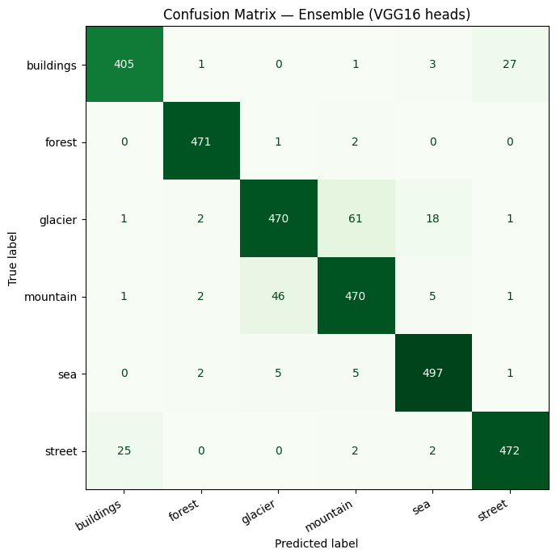 | 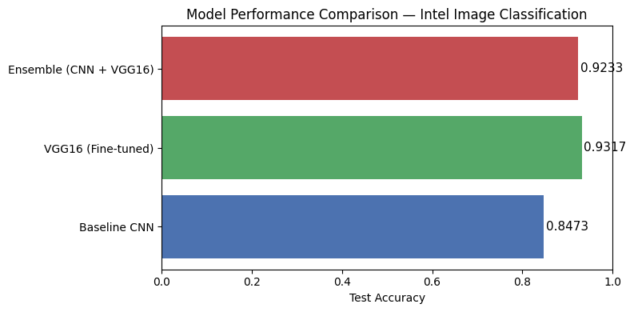 |
| 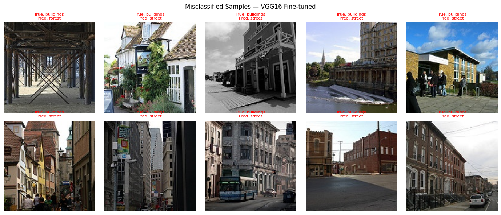 | 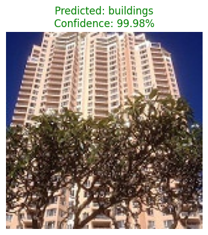 |

## Stack

NumPy, Matplotlib, Seaborn, TensorFlow/Keras, scikit-learn.

## Setup

```bash
pip install numpy matplotlib seaborn tensorflow scikit-learn
jupyter notebook fda-project.ipynb
```

Dataset expected under `seg_train/seg_train` and `seg_test/seg_test` (Kaggle Intel Image Classification structure).

## License

MIT — see [LICENSE](LICENSE).

---

## Author

**Jeyadev R** · AI/ML Engineer & Full-Stack Developer · Chennai, India

- Portfolio: [jeyadev.dev](https://jeyadev.dev/projects/intel-scene-classification)
- GitHub: [@jeyadev-jd](https://github.com/jeyadev-jd)
- LinkedIn: [r-jeyadev](https://www.linkedin.com/in/r-jeyadev)

If this project is useful to you, a ⭐ on the repo helps others find it.
